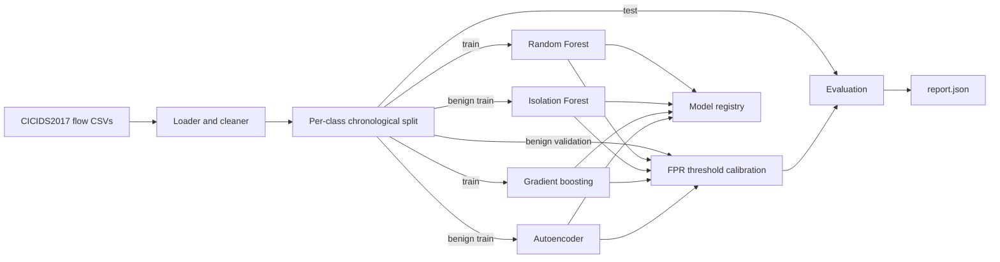

# AI-IDS

[](https://github.com/TurlaFSB/AI-IDS/actions/workflows/ci.yml)
[](LICENSE)


Machine-learning network intrusion detection for enterprise traffic, built around reproducible
evaluation, calibrated false-positive rates, and integrity-checked models.

> **Status: v0.1, foundation.** Offline training and evaluation are implemented and tested.
> Real-data results are reported below. Offline detectors, a scoring service and a dashboard exist;
> live capture, threat-intelligence enrichment and drift-triggered retraining are on the
> [roadmap](#roadmap). Nothing here is
> validated for production use yet.

## Contents

- [Why this project](#why-this-project)
- [Features](#features)
- [Architecture](#architecture)
- [Quickstart](#quickstart)
- [Live demo](#live-demo-scoring-service-and-dashboard)
- [Using CICIDS2017](#using-cicids2017)
- [Usage](#usage)
- [Evaluation methodology](#evaluation-methodology)
- [Results](#results)
- [Limitations](#limitations)
- [Project layout](#project-layout)
- [Documentation](#documentation)
- [Security](#security)
- [Roadmap](#roadmap)
- [Contributing](#contributing)
- [Citation and acknowledgements](#citation-and-acknowledgements)
- [License](#license)

## Why this project

Most published intrusion-detection work reports high accuracy on random splits of benchmark data.
Those numbers collapse on real networks for three recurring reasons: near-duplicate flows leak
between train and test, accuracy hides the false-alarm rate that actually limits a security team,
and models are deployed without integrity guarantees. AI-IDS is built to avoid all three:
chronological splits, thresholds calibrated to an explicit false-positive budget, and verified
model artifacts.

## Features

| Area | What is implemented |
|---|---|
| Data | CICIDS2017 loader: label normalisation, duplicate and non-finite value handling, timestamp repair |
| Splitting | Per-class chronological train / validation / test split (no random splits) |
| Detectors | Random Forest (supervised, multi-class), gradient boosting (supervised, continuous scores), Isolation Forest and an autoencoder (both unsupervised, benign-only training), optional evasion-aware variants and mean/max score fusion, all behind one scoring contract |
| Operating point | Alert threshold calibrated on held-out benign traffic to a target false-positive rate |
| Metrics | Recall, precision, F1, FPR, MCC, ROC-AUC, PR-AUC, per-attack recall with support, scoring latency (p50/p95/p99), time-block bootstrap confidence intervals, multi-seed spread |
| Model registry | SHA-256 manifest per artifact, optional HMAC-SHA256 signature, recorded environment versions |
| Threat mapping | Each attack type mapped to a MITRE ATT&CK technique for alert enrichment |
| Robustness | Feature-space evasion-sensitivity analysis (timing and packet-size reshaping) per detector, leave-one-attack-family-out test, per-day FPR and benign-drift (PSI) diagnostics |
| Service | Flask/waitress scoring API with bearer-key scopes, rate limiting, strict validation, security headers and CSP, Prometheus metrics, health probes, OpenAPI spec, a same-origin dashboard and a replay client (ADR 0010) |
| Supply chain | Hash-locked dependencies, SHA-pinned CI actions, digest-pinned non-root container image, `bandit`, `pip-audit`, Trivy, CycloneDX SBOM |
| Engineering | Typed (`mypy --strict`), linted, 85%+ coverage gate, CI on Python 3.11-3.13 |

## Architecture



More detail, including the scoring-service diagram, is in [docs/architecture.md](docs/architecture.md).

## Quickstart

Requires Python 3.11 or newer.

```bash
git clone https://github.com/TurlaFSB/AI-IDS.git
cd AI-IDS
python -m venv .venv
source .venv/bin/activate          # Windows: .venv\Scripts\activate
pip install -e ".[dev]"
# Fully reproducible, hash-verified install (recommended for CI and releases):
#   pip install --require-hashes -r requirements/dev.txt && pip install --no-deps -e .

# Verify the pipeline on synthetic data (no download needed)
ai-ids synth --out data/synthetic.csv --rows 30000
ai-ids train --data data/synthetic.csv --out models/demo --config configs/default.yaml
```

Results on synthetic data only show that the pipeline works. They say nothing about detection
performance on real traffic.

Run the quality gates:

```bash
ruff check src tests && ruff format --check src tests
mypy
pytest
```

### Container

```bash
docker build -t ai-ids .
docker run --rm --read-only ai-ids --version
# Mount data and config read-only, and an output directory explicitly:
docker run --rm --read-only \
  -v "$PWD/data:/data:ro" -v "$PWD/configs:/configs:ro" -v "$PWD/models:/out" \
  ai-ids train --data /data/raw/TrafficLabelling --out /out/run --config /configs/default.yaml
```

The image is multi-stage, runs as a non-root user, and pins its base image by digest.

## Live demo: scoring service and dashboard

A trained model can be served and watched in a browser. This runs on synthetic data and shows the
plumbing, not detection quality.

```bash
ai-ids synth --out data/synthetic.csv --rows 30000
ai-ids train --data data/synthetic.csv --out models/demo --config configs/light.yaml
ai-ids serve --model-dir models/demo/random_forest --demo   # prints the dashboard URL and keys
# second terminal, with the printed score key:
AI_IDS_API_KEY=<printed key> ai-ids replay --synthetic --rate 20
```


*Synthetic data. The dashboard shows throughput, alerts, request latency percentiles and recent
alerts with their ATT&CK technique IDs.*

For real deployments see the [runbook](docs/runbook.md) and [API reference](docs/api.md): the
service has no TLS of its own, binds to loopback unless told otherwise, and keeps alerts (which
may contain IP addresses) in memory only.

## Using CICIDS2017

1. Download the labelled flow files (`GeneratedLabelledFlows.zip` and its `.md5`) from the
   official source: <https://www.unb.ca/cic/datasets/ids-2017.html>. Follow the dataset's terms
   and cite it (see [Citation](#citation-and-acknowledgements)).
2. Verify the download against the published MD5, unzip into `data/raw/`, then record SHA-256
   digests of the CSVs for traceability:
   ```bash
   ai-ids checksum data/raw/TrafficLabelling
   ```
3. Train and evaluate:
   ```bash
   ai-ids train --data data/raw/TrafficLabelling --out models/cicids2017 --config configs/default.yaml
   ```

`data/` is git-ignored: datasets are never committed. The full dataset needs a few GB of RAM.
See [docs/data-governance.md](docs/data-governance.md) for provenance, privacy, and retention rules.

## Usage

```text
ai-ids synth     write a synthetic CICIDS2017-style CSV
ai-ids train     load, clean, split, train, calibrate, evaluate, and save detectors
ai-ids seeds     repeat training over several seeds and report the spread
ai-ids analyze   re-run evaluation diagnostics on a saved model without retraining
ai-ids holdout   leave-one-attack-family-out generalisation test (slow)
ai-ids checksum  print SHA-256 digests of dataset files
```

Experiments are configured in YAML ([configs/default.yaml](configs/default.yaml); `light.yaml` for
laptops, `robustness.yaml` to compare standard and evasion-aware training, ADR 0008): seed, target
false-positive rate, operating points, split fractions, and model hyperparameters. Unknown keys
are rejected.

To sign model artifacts, set `AI_IDS_MODEL_HMAC_KEY` (see [.env.example](.env.example)) before
training; the same key is then required to load them.

Each run writes to the output directory:

```text
<detector>/model.joblib, manifest.json     one directory per selected detector
report.json   metrics, operating points, per-attack recall, per-day FPR, drift, latency,
              dataset file SHA-256 digests, git commit and dirty flag
```

## Evaluation methodology

- **Chronological, per-class splits (no flow-level random splits).** Within each attack type the earliest 60% of flows train the
  model, the next 15% calibrate the threshold, and the latest 25% test it
  ([ADR 0002](docs/adr/0002-chronological-split.md)).
- **Threshold chosen without peeking.** The alert threshold is the benign validation-score
  quantile for the target FPR (default 1%), so validation FPR is bounded by construction. Test
  FPR is measured, not assumed ([ADR 0004](docs/adr/0004-fpr-calibrated-threshold.md)).
- **Accuracy is never the headline metric.** Traffic is heavily imbalanced; recall, FPR, and
  PR-AUC are reported, with per-attack recall and support.
- **Uncertainty.** Each report carries 95% time-block bootstrap intervals for recall, false-positive
  rate and precision (whole 5-minute blocks are resampled, because flows within an attack run are
  correlated; ADR 0009), and `ai-ids seeds` measures spread across random seeds.
- **Latency** is measured per scoring call, single inference thread, after warm-up.
- Results are reported at several operating points (0.1%, 1%, 5% target FPR), per capture day,
  per capture day and hour, with a profile of where false positives concentrate, and with a
  benign-traffic drift summary (Population Stability Index per feature).

## Results

First full run on CIC-IDS-2017 (default config at the time, seed 42, commit `5166bf2`; Random Forest
and Isolation Forest only; the later runs below add gradient boosting and the autoencoder). After cleaning there
are 2,522,525 flows; the test set has 630,647 flows, of which 106,485 (16.9%) are attacks.
Alert thresholds were calibrated for a **1% false-positive rate** on validation data.

| Model | Recall | Precision | False-positive rate (test) | F1 | MCC | ROC-AUC | PR-AUC | Macro recall |
|---|---|---|---|---|---|---|---|---|
| Random Forest | 0.990 | 0.713 | **0.081** | 0.829 | 0.804 | 0.998 | 0.993 | 0.870 |
| Isolation Forest | 0.040 | 0.195 | 0.034 | 0.066 | 0.013 | 0.829 | 0.354 | 0.133 |

Scoring latency, single thread: Random Forest 13.3 ms per single flow (p50), 30.6 ms per batch
of 1,000 (about 32,700 flows/s); Isolation Forest 18.3 ms and 28.1 ms (about 35,600 flows/s).

### All four detectors (second full run)

A repeat run reproduces the Random Forest and Isolation Forest results exactly (fixed seeds) and
adds the gradient-boosting detector and the autoencoder. Same split, same 1% validation target.

| Detector | Recall | Precision | False-positive rate (test) | PR-AUC | Macro recall |
|---|---|---|---|---|---|
| Random Forest | 0.990 | 0.713 | 0.081 | 0.993 | 0.870 |
| Gradient boosting | 0.868 | **0.985** | **0.0026** | 0.988 | 0.578 |
| Isolation Forest | 0.040 | 0.195 | 0.034 | 0.354 | 0.133 |
| Autoencoder | 0.153 | 0.294 | 0.074 | 0.459 | 0.057 |

Recall by attack category on the test split:

| Category (test flows) | Random Forest | Gradient boosting | Isolation Forest | Autoencoder |
|---|---|---|---|---|
| Botnet (490) | 0.00 | 0.00 | 0.00 | 0.00 |
| Brute force (2,291) | 0.99 | 0.92 | 0.00 | 0.00 |
| DDoS (32,005) | 1.00 | 1.00 | 0.07 | 0.01 |
| DoS (48,441) | 0.99 | 0.73 | 0.04 | 0.24 |
| Port scan (22,706) | 1.00 | 0.99 | 0.00 | 0.19 |
| Web attacks (538) | 0.99 | 0.88 | 0.00 | 0.00 |
| Heartbleed (4) / Infiltration (10) | 1.00 / 0.60 | 0.00 / 0.00 | 0.00 / 0.80 | 0.00 / 0.10 |

**What these numbers mean, honestly:**

- **The false-positive rate did not hold, and the misses are concentrated.** Thresholds targeted
  1% on validation, but test FPR was 8.1% (Random Forest) and 3.4% (Isolation Forest). By hour,
  Random Forest FPR was **35.1% on Thursday 6 July 15:00-16:00** (81,580 benign flows) and
  **17.0% during Friday's 16:00 hour** (65,462 benign flows), versus **0.06% to 0.31% in every
  other hour with at least 1,000 benign flows**, well under the 1% target. Two source hosts account for **98.6% of all false
  positives** (`192.168.10.8`: 67.3%, `192.168.10.50`: 31.2%), and the ports with the highest
  false-positive rates are rare ones scattered across the port range, which looks like scan
  traffic. Per-feature drift (PSI) is small (no feature above 0.25, maximum 0.12), so this is not
  broad distribution shift.

  **The evidence points to label noise, though it is not proof.** `192.168.10.8` produced 28,589
  false positives spanning exactly 1,000 distinct destination ports across 11 hosts between 15:10
  and 16:48 on Thursday, which is the signature of a default port scan: real scan traffic that the
  dataset labels benign. `192.168.10.50` produced 13,265 toward 12,450 distinct destination ports
  on only 3 hosts, which a server does not do on its own and looks like the reverse-direction view
  of attack connections. With these two hosts excluded the false-positive rate is 0.14%; that
  figure is a sensitivity analysis, not a performance claim. A consequence: a detector that flags
  these flows is penalised by the labels, and one that ignores them looks better than it may be.
- **Gradient boosting has the best operating behaviour on ordinary traffic.** It catches 87% of
  attacks at a 0.26% false-positive rate (below the 1% target) with 98.5% precision, against the
  Random Forest's 99% recall at 8.1% FPR and 71% precision. Its few false positives are almost all
  from the scanning host: `192.168.10.8` accounts for 99.8% of them (2.1% of that host's benign
  flows are flagged, against 43.9% for the Random Forest), and with that host excluded its
  false-positive rate is 0.0007%. So it is far cleaner on ordinary benign traffic, while on the
  attack-adjacent traffic the two models disagree and the labels cannot say which is right. It
  misses Heartbleed, Infiltration and Bot entirely and catches 73% of DoS.
- **The unsupervised detectors do not work well enough here.** The autoencoder ranks better than
  the Isolation Forest (PR-AUC 0.46 versus 0.35) but at 15% recall and a 7.4% false-positive rate
  it is not usable; it detects some DoS (0.24) and port scan (0.19) and little else. These are
  negative results and stay in the write-up. No detector detects the Bot family at the calibrated threshold (it does rank above most benign
  traffic: held-out AUC 0.86 and 0.90).
- **Packet-size shaping defeats the Random Forest in feature space.** At the calibrated threshold,
  recall falls from 0.990 to 0.513 when every packet carries 64 extra bytes (0.531 at 256 B, 0.508 at
  1,024 B). Slowing flows down costs little (0.979, 0.965, 0.950 at 2x, 5x, 10x). Per family, at 64
  bytes: port scan 0.997 to 0.014, web attacks 0.987 to 0.076, DDoS 0.998 to 0.585, DoS 0.991
  to 0.690, brute force 0.994 to 0.933. The model leans on absolute packet sizes. This is a
  feature-space analysis (derived features are shifted consistently; protocol limits such as the
  1,500-byte Ethernet MTU are not modelled), so read it as a sensitivity indicator.
- **Headline recall is dominated by three attack types.** DDoS, DoS Hulk and PortScan are 92% of
  attack flows. Averaged evenly over attack types, Random Forest recall is 0.87. Bot is missed
  entirely (recall 0.00, 490 test flows).
- **In-distribution recall is optimistic.** Attack runs are bursts of near-identical flows, so
  part of each run is in both train and test. Use `ai-ids holdout` (leave-one-family-out) to
  measure detection of attack families absent from training.
- **Detection of unseen attack families is weak.** In the leave-one-family-out test (Random
  Forest, 50 trees, the family removed from training, threshold set for 1% FPR on validation),
  recall on the unseen family was: web attacks 0.87, DDoS 0.58, brute force (FTP/SSH-Patator) 0.26,
  DoS 0.15, port scan 0.06, botnet 0.00. That is 0.32 averaged over the six families and 0.27
  pooled over flows, versus 0.99 on attacks the model was trained on. The Isolation Forest, which
  never sees attacks, does worse on every family (DDoS 0.07, DoS 0.04, port scan 0.001, the
  others 0.00). In-distribution recall mostly measures recognition of known attack tools.
- **Evasion-aware training works when the perturbation carries no label information.** The first
  design perturbed attack flows only and failed its benign control: the augmented Random Forest
  flagged 24%, 50% and 70% of benign flows padded by 64, 256 and 1,024 bytes (clean rate 7.1%), so
  its 1.000 recall under padding was a shortcut ("padded means attack"). The redesign (ADR 0008)
  perturbs benign and attack flows alike and trains on forward-only padding (what an attacker
  controls) plus slowdowns, with magnitudes that differ from evaluation and padding of both
  directions never trained on. Results on the test split (attack recall, with benign flows flagged
  under the same perturbation in brackets; clean benign rate 8.0% for the Random Forest):

  | Detector | Clean recall | Slow 10x | Forward padding 64 B | Padding both directions 64 B (unseen type) |
  |---|---|---|---|---|
  | Random Forest | 0.990 | 0.950 (8.5%) | 0.567 (1.1%) | 0.513 (0.0%) |
  | Random Forest, symmetric augmentation | 0.990 | 0.978 (8.3%) | **0.990** (7.5%) | **0.959** (1.8%) |
  | Gradient boosting | 0.868 | 0.785 (3.6%) | 0.517 (0.0%) | 0.466 (0.0%) |
  | Gradient boosting, symmetric augmentation | 0.988 | 0.954 (6.4%) | 0.986 (5.6%) | 0.716 (0.07%) |

  For the Random Forest, recall under padding rises from about 0.51 to 0.96-0.99 with no increase in
  benign flows flagged and no loss on clean data (macro recall 0.870 to 0.884); the full table is in
  the [model card](docs/model-card.md). Gradient boosting becomes robust to slowing and forward
  padding but its clean false-positive rate rises from 0.26% to 7.0% and precision falls from
  98.5% to 74.2%; the extra false positives are concentrated on two hosts (99.8% of them; 44% of one
  host's benign flows), the same scan-like traffic that drives the Random Forest's, and with those
  hosts excluded the rate is 0.019% (a sensitivity analysis, not a performance claim; whether
  those flows are truly benign cannot be settled without verified labels). All of this is feature-space, single-seed, and against
  the perturbation families modelled, not against an adaptive adversary.
- **Random Forest scores are coarse.** The score is the share of trees voting "attack", so very
  low FPR targets collapse (at a 0.1% target the threshold saturates and nothing is flagged).
  A finer or calibrated score is needed for low-FPR operation.
- **The Isolation Forest is a weak baseline** on this dataset: most attacks are not outliers in
  raw flow-feature space. It detects slowhttptest (72%) but little else.
- Heartbleed (4 test flows), Infiltration (10) and SQL injection (6) are too small for recall
  to mean anything.

Reproduce with `ai-ids train`; the full per-attack table, results at other operating points,
per-day and per-hour false-positive rates, false-positive profile, per-attack recall at every
operating point, and feature-drift (PSI) summaries are in `report.json`. `ai-ids analyze` recomputes
these from a saved model in minutes; it refuses to run if the data or split differ from training.

### Uncertainty, seed spread and score fusion

Run: `ai-ids train --config configs/robustness.yaml` and `ai-ids seeds --seeds 42 43 44` on the full
CICIDS2017 data (same split and 1% validation FPR target as above). Intervals are 95% time-block
bootstrap intervals (5-minute blocks, 2,000 resamples). The seed study uses the sample standard
deviation of three seeds; it measures model randomness only, because the split is fixed.

| Detector | Recall [95% CI] | False-positive rate [95% CI] | Precision | PR-AUC | Macro recall |
|---|---|---|---|---|---|
| Random Forest | 0.990 [0.968, 0.995] | 0.081 [0.040, 0.121] | 0.713 | 0.993 | 0.870 |
| Random Forest, augmented | 0.990 [0.970, 0.995] | 0.080 [0.040, 0.119] | 0.716 | 0.993 | 0.884 |
| Gradient boosting | 0.868 [0.657, 0.967] | 0.0026 [0.0007, 0.0052] | 0.985 | 0.988 | 0.578 |
| Gradient boosting, augmented | 0.988 [0.967, 0.993] | 0.070 [0.032, 0.109] | 0.742 | 0.976 | 0.806 |
| Fusion (mean) | 0.991 [0.972, 0.995] | 0.074 [0.035, 0.114] | 0.730 | 0.986 | 0.823 |
| Fusion (max) | 0.991 [0.972, 0.995] | 0.080 [0.040, 0.120] | 0.715 | 0.993 | 0.897 |

Across seeds 42, 43 and 44 (mean ± standard deviation):

| Detector | Recall | False-positive rate | Precision |
|---|---|---|---|
| Random Forest | 0.9900 ± 0.0003 | 0.076 ± 0.007 | 0.726 ± 0.019 |
| Random Forest, augmented | 0.9901 ± 0.0006 | 0.077 ± 0.005 | 0.723 ± 0.014 |
| Gradient boosting | 0.878 ± 0.013 | 0.0026 ± 0.0001 | 0.986 ± 0.001 |
| Gradient boosting, augmented | 0.976 ± 0.015 | 0.059 ± 0.009 | 0.770 ± 0.024 |

What this does and does not show:
- **Fusion did not help.** Neither rule separates from its best component: every recall and
  false-positive interval overlaps the Random Forest's. Mean fusion lowers PR-AUC (0.986 against
  0.993); max fusion has the highest macro recall (0.897) but the difference from the augmented
  Random Forest (0.884) is small and was measured once. Fusion adds model size and inference cost,
  so the single augmented Random Forest remains the simpler choice on this evidence.
- **The intervals are wide where it matters.** The Random Forest false-positive rate spans roughly
  4% to 12%, because false alarms cluster in a few time blocks; a single point estimate
  says little about the false-alarm rate a deployment would see. Gradient boosting's recall interval (0.66 to 0.97) is
  wider still because its misses sit in few attack runs.
- **No detector except plain gradient boosting meets the 1% calibration target on the test split**
  (see the temporal-shift section); the intervals do not change that.
- **Seed spread is small for the Random Forest and larger for gradient boosting**
  (augmented recall ± 0.015, false-positive rate ± 0.009), so gaps of that size between
  gradient-boosting variants should not be read as real. Three seeds is a small sample, and seed
  spread excludes split and dataset variation.
- Seed spread was not measured for the fusion detectors or for the evasion results; the
  evasion numbers elsewhere in this document remain single-seed.

The exact commit is recorded in `report.json` (`git_commit`); these tables are transcribed from the
console output and `report.json` of the run, not recomputed.

### Corrected labels (tooling ready, results pending)

CICIDS2017's shipped labels contain documented errors. `ai-ids relabel --data <2017 folder> --out
relabel.json` re-labels the original flows with rules re-implemented from the attack timelines
published by Engelen, Rimmer and Joosen (IEEE SPW 2021) and Liu, Engelen, Lynar, Essam and Joosen
(IEEE CNS 2022) and writes an old-versus-new label table; `corrected_labels: true` in a config trains
and evaluates on the corrected labels (`configs/corrected.yaml`). Flows that belong to an attack
timeline but carry no attack payload are dropped and counted. This corrects labels only, not the
flows (the authors also repaired the flow extractor), and the port has not been checked against
their corrected CSVs; see [ADR 0013](docs/adr/0013-corrected-labels.md).

**First relabel run** (`ai-ids relabel`, all eight CICIDS2017 files, 3,119,345 flows; counts are before
deduplication): 2,918,597 flows keep their label, **101,084 benign flows become attack**, 25 attack
flows become benign, 1 changes attack type, and **99,638 flows are dropped as "attempted"**. The
changes are concentrated where the literature says the original labels fail:

| File | Benign to attack | Dropped as attempted |
|---|---|---|
| Thursday afternoon (infiltration) | 65,638 | 31 |
| Friday afternoon DDoS | 31,339 | 351 |
| Wednesday (DoS, Heartbleed) | 4,058 | 86,336 |
| Tuesday (FTP, SSH) | 20 | 8,492 |
| Thursday morning (web attacks) | 6 | 3,315 |
| Friday port scan, Friday morning (Bot), Monday | 23, 0, 0 | 623, 490, 0 |

After cleaning, the corrected counts include 40,306 `infiltration_portscan` flows (the scan from
the compromised host `192.168.10.8` that dominated our models' false positives was labelled benign
originally) and 159,355 DDoS flows (31,339 more than before, the server's side of the DDoS). Web attacks
shrink to 74 brute-force, 18 XSS and 25 SQL-injection flows because most of the original web-attack
flows are attempts without attack payload. Bot falls to 1,459 flows. These counts are what the port
produces; whether they match the authors' own corrected CSVs has not been checked. No model has been
retrained on them yet.

### Attack-family comparison across datasets

`ai-ids family --source-data <2017> --target-data <2018> --category botnet --model-dir ...` compares
one family across two datasets without training: which features separate it from benign traffic in
each, whether directions agree, where a saved model's scores place it (on held-out source flows
only), and which categories a multi-class model assigns it. It is descriptive; differences may come
from the attack tool, the network, the capture or label definitions.

**Bot, CICIDS2017 against the 2018 files** (models from `configs/robustness.yaml`; the 2018 files are
truncated, see the data caveat below):
- The datasets disagree on what separates Bot from benign traffic: rank correlation of the 78
  per-feature effects is 0.32, and of the five features in both top-15 lists four point the same
  way. `fwd_packet_length_mean` flips direction (AUC 0.38 on 2017, 0.81 on 2018, so 2017 Bot has
  smaller forward packets than benign traffic and 2018 Bot larger ones). `destination_port`
  separates it similarly in both (0.82 and 0.81).
- `rst_flag_count` (AUC 0.93 on 2018, about 0.50 on 2017) and `ece_flag_count` are the same column
  in the 2018 files (equal in all but 1 of 1,048,575 rows of the Bot day), so they are one signal,
  not two.
- Scored on held-out source flows only: Bot ranks above benign traffic on 2017 too (AUC 0.86 for
  the Random Forest, 0.90 for gradient boosting; 490 test flows), but none of it clears the
  calibrated threshold. On the 2018 Bot flows the AUCs are 0.92 and 0.99, and none clear the
  stored threshold. The gradient-boosting scores for 2018 Bot lie in a narrow band (about 0.16 to
  0.31) above benign traffic and far below the 0.999 threshold.
- The Random Forest assigns **100%** of the 2018 Bot flows to "benign". The idea that 2018 Bot
  resembles other 2017 attack families is therefore not supported. Why gradient boosting ranks it so
  well, and whether the signal reflects the attack or a capture artefact, is not established.
- Correction to earlier wording: "no detector detects Bot" means recall 0 at the 1% operating point,
  not that Bot is invisible to the models.

### Adaptive evasion in feature space

`ai-ids adaptive` gives a per-flow adversary a grid of slowdown factors (1, 2, 5, 10, 30) and
forward-padding amounts (0, 32, 128, 512, 1,024, 1,460 bytes), scores all 30 combinations with the
saved model and keeps each flow's lowest score (ADR 0012). It ran on a sample of up to 20,000 attack
and 20,000 benign flows from the CICIDS2017 test split (seed 42, models from
`configs/robustness.yaml`, tool at commit `19a527b`). The benign control is the share of benign flows
flagged under *any* combination; a large rise over the clean false-positive rate would indicate a
"perturbed means attack" shortcut.

| Detector | Clean recall | Adaptive recall | Benign flagged under any combination (clean rate) |
|---|---|---|---|
| Random Forest | 0.990 | **0.518** | 0.128 (0.084) |
| Random Forest, evasion-aware | 0.990 | **0.895** | 0.099 (0.083) |
| Gradient boosting | 0.865 | 0.483 | 0.041 (0.002) |
| Gradient boosting, evasion-aware | 0.987 | 0.878 | 0.077 (0.073) |

Reading it:
- A per-flow adversary cuts the plain Random Forest from 0.99 to 0.52. Evasion-aware training holds
  the adaptive recall at 0.90, so most of the defence survives an adaptive search, but not all of it:
  roughly ten points are still lost.
- The benign control does not show the old shortcut: the evasion-aware Random Forest flags 9.9% of
  benign flows under its worst combination against 8.3% clean (a rise of 1.6 points; the plain model
  rises by 4.4).
- The aggregate hides the family picture. Evasion-aware Random Forest, clean to adaptive recall:
  web attacks 0.97 to **0.02** (about 90 of 93 sampled flows to 2), DoS 0.99 to 0.80, brute force
  0.99 to 0.94, port scan 1.00 to 0.99, DDoS 1.00 to 1.00, Bot 0 to 0. The overall 0.895 is dominated
  by the two large families that barely move. The web-attack class is small, so that figure is noisy,
  but a per-flow adversary evades nearly all of it.
- Frontier (evasion-aware Random Forest, recall against what the adversary may use): slowing flows
  up to 30x with no padding gives 0.959; adding at most 32 bytes of forward padding gives 0.913;
  the full budget (30x and 1,460 bytes) gives 0.895. Slowing up to 5x and padding up to 128 bytes
  costs only 1.5 points (0.974).
- Limits that apply to every number here: derived features, not packets; only timing and forward
  packet size are reshaped; the transformations assume the attack still works afterwards; the grid
  is coarse, so a larger budget or other features could evade more; one seed; sampled flows (clean
  recall differs slightly from the full test split for that reason). 

### Cross-dataset transfer: CICIDS2017 to CSE-CIC-IDS2018

`ai-ids transfer` scores a second dataset with a saved model and its threshold fixed at training
time, with no refitting (ADR 0011). Models were trained on CICIDS2017 (`configs/robustness.yaml`,
seed 42); the target was three CSE-CIC-IDS2018 day files (Thursday 15 Feb, Thursday 22 Feb, Friday
2 Mar), cleaned and deduplicated to 2,560,995 flows, then a seeded random sample of 1,000,000 flows:
923,178 benign and 76,822 attacks (Bot 56,578; DoS GoldenEye 16,181; DoS Slowloris 3,945; web
attacks 118 in total). All 78 model features matched after column aliasing.

| Model (trained on 2017) | Stored threshold: recall / FPR / precision | Oracle re-calibrated: recall / FPR | PR-AUC on 2018 |
|---|---|---|---|
| Random Forest, evasion-aware | 0.085 / 0.0005 / 0.930 | 0.127 / 0.0030 | 0.506 |
| Gradient boosting | 0.049 / 0.0001 / 0.972 | 0.830 / 0.0026 | 0.898 |

Adding `--calibration-fraction 0.15` also reports a deployable counterpart: the threshold is set
from benign flows in the earliest 15% of the target by time and every metric is computed on the
later flows only (the stored threshold is reported on the same flows).

**Local calibration result (gradient boosting).** The calibration slice was the earliest 150,000
flows of the sample (2018-02-15 01:00 to 08:51, all benign, before any attack); the 850,000 later
flows hold all 76,822 attacks. With a threshold set on that slice at the 1% target, recall is
**0.830** at a false-positive rate of 0.26% and precision 0.970, against 0.049, 0.01% and 0.978
for the stored 2017 threshold on the same flows. The local threshold (0.1301) equals the oracle
threshold exactly, so a benign-only window of this size recovers everything the oracle did. The
realised false-positive rate is 0.26%, not the 1% target, because gradient-boosting scores are
heavily tied at that value. Caveats: this assumes an operator can obtain a clean benign window from
the new network, the window here is the quiet start of one day (a favourable case), it is one
model and one sample, and the Random Forest was not tried (its oracle recall was only 0.127).
Nine flows in the 2018 files have corrupted dates (1970); they are set to missing and excluded
(`timestamps_set_missing_as_implausible` in the report).

The "oracle" point chooses a threshold from the target's own benign labels at the training false-
positive target, so it is an upper bound on what recalibration could recover, not a deployable
setting.

**Data caveat for everything in this section.** Each of the three 2018 day files holds exactly
1,048,575 rows, which is Excel's row limit minus the header, so they were almost certainly truncated
by an Excel export and contain only the first part of each day (the loader now flags any file with
that exact row count in the log and in the cleaning report). Attack counts for the DoS and web
attack classes are therefore partial (the 118 web-attack flows are far fewer than that class should
have; we did not verify the original counts), and the attack mix here is not the dataset's full mix.
The Bot day looks complete enough to matter (its Bot flows are numerous), but that is not verified
either. Treat the numbers as a cross-dataset smoke test on truncated files, not a full benchmark.

What this shows and does not show:
- **A threshold fixed on 2017 does not carry over.** Both models almost never alert on 2018
  (false-positive rate 0.01% to 0.05%, against a 1% target) and miss over 90% of attacks. What
  they do flag is correct (precision 0.93 and 0.97), so the failure is missed attacks, not noise.
- **The two models fail for different reasons.** Gradient boosting still ranks 2018 flows well
  (PR-AUC 0.898), and with a threshold set on the target's benign traffic it would catch 83% of
  attacks at a 0.26% false-positive rate; its stored threshold is simply wrong for the new
  scores. The Random Forest ranks poorly (PR-AUC 0.506) and recalibration barely helps (recall
  0.127), so its problem is the ranking itself.
- **By category the picture is sharper** (recall; support in brackets):

  | Category | GB stored | GB oracle | RF-aug stored | RF-aug oracle |
  |---|---|---|---|---|
  | Botnet (56,578) | 0.000 | **0.956** | 0.000 | 0.004 |
  | DoS (20,126) | 0.185 | 0.478 | 0.322 | 0.472 |
  | Web attacks (118) | 0.000 | 0.305 | 0.119 | 0.314 |

  ROC-AUC, which does not depend on attack prevalence, is 0.988 for gradient boosting and 0.936 for
  the evasion-aware Random Forest. Gradient boosting ranks 2018 Bot flows almost perfectly (0.956 at
  a 0.26% false-positive rate) yet its stored threshold catches none of them; the Random Forest
  cannot separate them at all (0.004). Neither model gets past about 0.48 on DoS even with the
  oracle threshold, so DoS transfers poorly whatever the threshold. Bot is the family every
  detector missed on 2017, yet gradient boosting ranks 2018 Bot well. Whether the 2018 Bot traffic
  differs from, or is simply easier than, the 2017 Bot traffic is not established here; the
  web-attack figures rest on 118 flows.
- PR-AUC depends on attack prevalence (7.7% here against 16.9% in the 2017 test set), so it is not
  directly comparable across the two datasets; ROC-AUC is in the report files.
- Two models, one seed, one 1,000,000-flow sample of three days, no confidence interval is quoted
  here, and the web-attack classes have 118 flows in total, so nothing is claimed for them. The
  2018 and 2017 captures also differ in attacker tools, network and label definitions, so a drop
  cannot be attributed to one cause.

## Limitations

- CICIDS2017 has documented labelling and flow-construction problems
  (see Engelen, Rimmer and Joosen, "Troubleshooting an Intrusion Detection Dataset: the CICIDS2017
  Case Study", IEEE Security and Privacy Workshops, 2021). Corrected-label support now exists (ADR 0013) but has not been run on the real data;
  treat early numbers as provisional.
- Attacks in the dataset come from a small set of tools, so models learn tool signatures; the
  leave-one-family-out test above quantifies how little carries over to unseen families.
- Very small classes (Heartbleed, Infiltration) have tiny test sets and unreliable recall.
- Everything except the cross-dataset test above is measured on one dataset (CICIDS2017); the
  cross-dataset test shows a fixed 2017 threshold failing on 2018 traffic.
- The evasion analysis is feature-space only (not packet-level); performance on other networks is
  unknown.
- Model artifacts are pickle-based: load only verified artifacts from storage you control.
- The service is single-process with in-memory state, shared-key authentication and no TLS of its
  own. It has been tested by the project's own suite and manual browser checks, not by an
  independent assessment, and no throughput or capacity figures have been measured.

## Project layout

```text
src/ai_ids/
  labels.py        attack taxonomy and MITRE ATT&CK mapping
  data/            loader, chronological split, synthetic generator
  models/          Random Forest and Isolation Forest detectors
  evaluation/      metrics and latency profiling
  registry.py      integrity-checked model artifacts
  pipeline.py      train + evaluate + persist
  service/         scoring API, dashboard, replay client
  cli.py           ai-ids command
configs/           experiment configuration
docs/              architecture, threat model, compliance, data governance, model card, ADRs
tests/             unit and end-to-end tests
```

## Documentation

| Document | Purpose |
|---|---|
| [Talk outline](docs/talk-outline.md) | Ten-minute presentation structure with hard questions |
| [Results at a glance](docs/results-summary.md) | One-page summary of findings and what is not shown |
| [Architecture](docs/architecture.md) | Components, data flow, target design |
| [Threat model](docs/threat-model.md) | STRIDE analysis and mitigations |
| [Standards alignment](docs/compliance.md) | NIST CSF 2.0, NIST SP 800-53, MITRE ATT&CK, OWASP ASVS |
| [API reference](docs/api.md) | Endpoints, authentication, errors, configuration |
| [Runbook](docs/runbook.md) | Operating the scoring service |
| [Data governance](docs/data-governance.md) | Provenance, privacy (GDPR), retention |
| [Model card](docs/model-card.md) | Intended use, evaluation protocol, limitations |
| [Decision records](docs/adr/README.md) | Why the design is the way it is |
| [Changelog](CHANGELOG.md) | Release history |

## Security

- Report vulnerabilities privately; see [SECURITY.md](SECURITY.md).
- Model artifacts are verified (SHA-256, optional HMAC-SHA256) before loading, but they remain
  pickle-based: loading one executes code. Only load artifacts you trained and stored yourself.
- Datasets, captures, trained models, and secrets are git-ignored and must never be committed.
- Dependencies are hash-locked and installed with `--require-hashes`; third-party CI actions are
  pinned to commit SHAs; the container base image is pinned by digest and scanned with Trivy; CI
  also runs `bandit`, `pip-audit`, and produces a CycloneDX SBOM ([ADR 0006](docs/adr/0006-supply-chain-integrity.md)).

## Roadmap

1. **Milestone 2:** evaluate the autoencoder and gradient-boosting detectors on real data against
   the unseen-family benchmark; error analysis of the Bot miss; corrected-label support; a
   PyTorch/GPU autoencoder only if the CPU baseline proves insufficient (ADR 0007).
2. **Milestone 3:** Scoring service with Prometheus metrics, dashboard and replay demo (done, ADR 0010); live flow capture from a network interface (not started).
3. **Milestone 4:** Threat-intelligence enrichment (AbuseIPDB, AlienVault OTX) with caching and a
   local blocklist fallback; ATT&CK-tagged alerts.
4. **Milestone 5:** Drift detection (PSI/KS) gating scheduled retraining, with champion/challenger
   promotion and rollback.
5. **Milestone 6:** Live capture through the scoring service; packet-level adversarial evaluation.

## Contributing

Contributions are welcome; see [CONTRIBUTING.md](CONTRIBUTING.md) and the
[Code of Conduct](CODE_OF_CONDUCT.md).

## Citation and acknowledgements

To cite this software, use [CITATION.cff](CITATION.cff) (GitHub's "Cite this repository").

This project uses the CIC-IDS-2017 dataset from the Canadian Institute for Cybersecurity,
University of New Brunswick. If you use results derived from it, cite:

> I. Sharafaldin, A. H. Lashkari, and A. A. Ghorbani, "Toward Generating a New Intrusion Detection
> Dataset and Intrusion Traffic Characterization," *4th International Conference on Information
> Systems Security and Privacy (ICISSP)*, 2018.

## License

[MIT](LICENSE)
