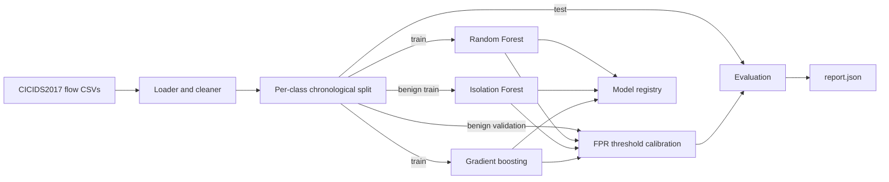

# AI-IDS

[](https://github.com/TurlaFSB/AI-IDS/actions/workflows/ci.yml)
[](LICENSE)


Machine-learning network intrusion detection for enterprise traffic, built around reproducible
evaluation, calibrated false-positive rates, and integrity-checked models.

> **Status: v0.1, foundation.** Offline training and evaluation are implemented and tested.
> Real-data results are pending; live capture, threat-intelligence enrichment, drift-triggered
> retraining, an autoencoder, and a dashboard are on the [roadmap](#roadmap). Nothing here is
> validated for production use yet.

## Contents

- [Why this project](#why-this-project)
- [Features](#features)
- [Architecture](#architecture)
- [Quickstart](#quickstart)
- [Using CICIDS2017](#using-cicids2017)
- [Usage](#usage)
- [Evaluation methodology](#evaluation-methodology)
- [Results](#results)
- [Limitations](#limitations)
- [Project layout](#project-layout)
- [Documentation](#documentation)
- [Security](#security)
- [Roadmap](#roadmap)
- [Contributing](#contributing)
- [Citation and acknowledgements](#citation-and-acknowledgements)
- [License](#license)

## Why this project

Most published intrusion-detection work reports high accuracy on random splits of benchmark data.
Those numbers collapse on real networks for three recurring reasons: near-duplicate flows leak
between train and test, accuracy hides the false-alarm rate that actually limits a security team,
and models are deployed without integrity guarantees. AI-IDS is built to avoid all three:
chronological splits, thresholds calibrated to an explicit false-positive budget, and verified
model artifacts.

## Features

| Area | What is implemented |
|---|---|
| Data | CICIDS2017 loader: label normalisation, duplicate and non-finite value handling, timestamp repair |
| Splitting | Per-class chronological train / validation / test split (no random splits) |
| Detectors | Random Forest (supervised, multi-class), Isolation Forest (unsupervised, benign-only training), and gradient boosting (supervised, continuous scores) behind one scoring contract |
| Operating point | Alert threshold calibrated on held-out benign traffic to a target false-positive rate |
| Metrics | Recall, precision, F1, FPR, MCC, ROC-AUC, PR-AUC, per-attack recall with support, scoring latency (p50/p95/p99) |
| Model registry | SHA-256 manifest per artifact, optional HMAC-SHA256 signature, recorded environment versions |
| Threat mapping | Each attack type mapped to a MITRE ATT&CK technique for alert enrichment |
| Robustness | Feature-space evasion-sensitivity analysis (timing and packet-size reshaping) per detector, leave-one-attack-family-out test, per-day FPR and benign-drift (PSI) diagnostics |
| Supply chain | Hash-locked dependencies, SHA-pinned CI actions, digest-pinned non-root container image, `bandit`, `pip-audit`, Trivy, CycloneDX SBOM |
| Engineering | Typed (`mypy --strict`), linted, 85%+ coverage gate, CI on Python 3.11-3.13 |

## Architecture



More detail, including the target architecture, is in [docs/architecture.md](docs/architecture.md).

## Quickstart

Requires Python 3.11 or newer.

```bash
git clone https://github.com/TurlaFSB/AI-IDS.git
cd AI-IDS
python -m venv .venv
source .venv/bin/activate          # Windows: .venv\Scripts\activate
pip install -e ".[dev]"
# Fully reproducible, hash-verified install (recommended for CI and releases):
#   pip install --require-hashes -r requirements/dev.txt && pip install --no-deps -e .

# Verify the pipeline on synthetic data (no download needed)
ai-ids synth --out data/synthetic.csv --rows 30000
ai-ids train --data data/synthetic.csv --out models/demo --config configs/default.yaml
```

Results on synthetic data only show that the pipeline works. They say nothing about detection
performance on real traffic.

Run the quality gates:

```bash
ruff check src tests && ruff format --check src tests
mypy
pytest
```

### Container

```bash
docker build -t ai-ids .
docker run --rm --read-only ai-ids --version
# Mount data and config read-only, and an output directory explicitly:
docker run --rm --read-only \
  -v "$PWD/data:/data:ro" -v "$PWD/configs:/configs:ro" -v "$PWD/models:/out" \
  ai-ids train --data /data/raw/TrafficLabelling --out /out/run --config /configs/default.yaml
```

The image is multi-stage, runs as a non-root user, and pins its base image by digest.

## Using CICIDS2017

1. Download the labelled flow files (`GeneratedLabelledFlows.zip` and its `.md5`) from the
   official source: <https://www.unb.ca/cic/datasets/ids-2017.html>. Follow the dataset's terms
   and cite it (see [Citation](#citation-and-acknowledgements)).
2. Verify the download against the published MD5, unzip into `data/raw/`, then record SHA-256
   digests of the CSVs for traceability:
   ```bash
   ai-ids checksum data/raw/TrafficLabelling
   ```
3. Train and evaluate:
   ```bash
   ai-ids train --data data/raw/TrafficLabelling --out models/cicids2017 --config configs/default.yaml
   ```

`data/` is git-ignored: datasets are never committed. The full dataset needs a few GB of RAM.
See [docs/data-governance.md](docs/data-governance.md) for provenance, privacy, and retention rules.

## Usage

```text
ai-ids synth     write a synthetic CICIDS2017-style CSV
ai-ids train     load, clean, split, train, calibrate, evaluate, and save detectors
ai-ids holdout   leave-one-attack-family-out generalisation test (slow)
ai-ids checksum  print SHA-256 digests of dataset files
```

Experiments are configured in YAML ([configs/default.yaml](configs/default.yaml)): seed, target
false-positive rate, operating points, split fractions, and model hyperparameters. Unknown keys
are rejected.

To sign model artifacts, set `AI_IDS_MODEL_HMAC_KEY` (see [.env.example](.env.example)) before
training; the same key is then required to load them.

Each run writes to the output directory:

```text
<detector>/model.joblib, manifest.json     one directory per selected detector
report.json   metrics, operating points, per-attack recall, per-day FPR, drift, latency,
              dataset file SHA-256 digests, git commit and dirty flag
```

## Evaluation methodology

- **Chronological, per-class splits (no flow-level random splits).** Within each attack type the earliest 60% of flows train the
  model, the next 15% calibrate the threshold, and the latest 25% test it
  ([ADR 0002](docs/adr/0002-chronological-split.md)).
- **Threshold chosen without peeking.** The alert threshold is the benign validation-score
  quantile for the target FPR (default 1%), so validation FPR is bounded by construction. Test
  FPR is measured, not assumed ([ADR 0004](docs/adr/0004-fpr-calibrated-threshold.md)).
- **Accuracy is never the headline metric.** Traffic is heavily imbalanced; recall, FPR, and
  PR-AUC are reported, with per-attack recall and support.
- **Latency** is measured per scoring call, single inference thread, after warm-up.
- Results are reported at several operating points (0.1%, 1%, 5% target FPR), per capture day,
  per capture day and hour, with a profile of where false positives concentrate, and with a
  benign-traffic drift summary (Population Stability Index per feature).

## Results

First full run on CIC-IDS-2017 (default config at the time, seed 42, commit `5166bf2`; Random Forest and Isolation Forest only,
the gradient-boosting detector has not been evaluated on real data yet). After cleaning there
are 2,522,525 flows; the test set has 630,647 flows, of which 106,485 (16.9%) are attacks.
Alert thresholds were calibrated for a **1% false-positive rate** on validation data.

| Model | Recall | Precision | False-positive rate (test) | F1 | MCC | ROC-AUC | PR-AUC | Macro recall |
|---|---|---|---|---|---|---|---|---|
| Random Forest | 0.990 | 0.713 | **0.081** | 0.829 | 0.804 | 0.998 | 0.993 | 0.870 |
| Isolation Forest | 0.040 | 0.195 | 0.034 | 0.066 | 0.013 | 0.829 | 0.354 | 0.133 |

Scoring latency, single thread: Random Forest 13.3 ms per single flow (p50), 30.6 ms per batch
of 1,000 (about 32,700 flows/s); Isolation Forest 18.3 ms and 28.1 ms (about 35,600 flows/s).

**What these numbers mean, honestly:**

- **The false-positive rate did not hold, and the miss is concentrated.** Thresholds targeted 1%
  on validation, but test FPR was 8.1% (Random Forest) and 3.4% (Isolation Forest). Per capture
  day, Random Forest FPR was **22.2% on Thursday 6 July** (129,056 benign test flows) versus
  **3.5% on Friday 7 July** (395,106 benign test flows); the overall 8.1% is that blend. Per-feature
  drift (PSI) between training and test benign traffic is small: no feature is above the
  "significant" threshold of 0.25 (maximum 0.12, on backward packet-length features), so this is
  not broad distribution shift. A specific subset of Thursday traffic is the likely cause; one
  hypothesis, **not yet verified**, is flows around the Thursday-afternoon infiltration session,
  where the dataset's labels are known to be noisy. `report.json` now includes hourly rates and a
  false-positive profile (which ports and hosts the false alarms cluster on) to test this.
- **Headline recall is dominated by three attack types.** DDoS, DoS Hulk and PortScan are 92% of
  attack flows. Averaged evenly over attack types, Random Forest recall is 0.87. Bot is missed
  entirely (recall 0.00, 490 test flows).
- **In-distribution recall is optimistic.** Attack runs are bursts of near-identical flows, so
  part of each run is in both train and test. Use `ai-ids holdout` (leave-one-family-out) to
  measure detection of attack families absent from training.
- **Random Forest scores are coarse.** The score is the share of trees voting "attack", so very
  low FPR targets collapse (at a 0.1% target the threshold saturates and nothing is flagged).
  A finer or calibrated score is needed for low-FPR operation.
- **The Isolation Forest is a weak baseline** on this dataset: most attacks are not outliers in
  raw flow-feature space. It detects slowhttptest (72%) but little else.
- Heartbleed (4 test flows), Infiltration (10) and SQL injection (6) are too small for recall
  to mean anything.

Reproduce with `ai-ids train`; the full per-attack table, results at other operating points,
per-day and per-hour false-positive rates, false-positive profile, and feature-drift (PSI)
summaries are in `report.json`.

## Limitations

- CICIDS2017 has documented labelling and flow-construction problems
  (see Engelen, Rimmer and Joosen, "Troubleshooting an Intrusion Detection Dataset: the CICIDS2017
  Case Study", IEEE Security and Privacy Workshops, 2021). Corrected-label support is planned;
  treat early numbers as provisional.
- Attacks in the dataset come from a small set of tools, so models may learn tool signatures.
- Very small classes (Heartbleed, Infiltration) have tiny test sets and unreliable recall.
- The evasion analysis is feature-space only (not packet-level); performance on other networks is
  unknown.
- Model artifacts are pickle-based: load only verified artifacts from storage you control.

## Project layout

```text
src/ai_ids/
  labels.py        attack taxonomy and MITRE ATT&CK mapping
  data/            loader, chronological split, synthetic generator
  models/          Random Forest and Isolation Forest detectors
  evaluation/      metrics and latency profiling
  registry.py      integrity-checked model artifacts
  pipeline.py      train + evaluate + persist
  cli.py           ai-ids command
configs/           experiment configuration
docs/              architecture, threat model, compliance, data governance, model card, ADRs
tests/             unit and end-to-end tests
```

## Documentation

| Document | Purpose |
|---|---|
| [Architecture](docs/architecture.md) | Components, data flow, target design |
| [Threat model](docs/threat-model.md) | STRIDE analysis and mitigations |
| [Standards alignment](docs/compliance.md) | NIST CSF 2.0, NIST SP 800-53, MITRE ATT&CK, OWASP ASVS |
| [Data governance](docs/data-governance.md) | Provenance, privacy (GDPR), retention |
| [Model card](docs/model-card.md) | Intended use, evaluation protocol, limitations |
| [Decision records](docs/adr/README.md) | Why the design is the way it is |
| [Changelog](CHANGELOG.md) | Release history |

## Security

- Report vulnerabilities privately; see [SECURITY.md](SECURITY.md).
- Model artifacts are verified (SHA-256, optional HMAC-SHA256) before loading, but they remain
  pickle-based: loading one executes code. Only load artifacts you trained and stored yourself.
- Datasets, captures, trained models, and secrets are git-ignored and must never be committed.
- Dependencies are hash-locked and installed with `--require-hashes`; third-party CI actions are
  pinned to commit SHAs; the container base image is pinned by digest and scanned with Trivy; CI
  also runs `bandit`, `pip-audit`, and produces a CycloneDX SBOM ([ADR 0006](docs/adr/0006-supply-chain-integrity.md)).

## Roadmap

1. **Milestone 2:** error analysis of the Bot miss and of false positives by day; finer or
   calibrated scores for low-FPR operation; PyTorch autoencoder (GPU) as a third detector;
   corrected-label support.
2. **Milestone 3:** Live flow capture and real-time scoring service with Prometheus metrics.
3. **Milestone 4:** Threat-intelligence enrichment (AbuseIPDB, AlienVault OTX) with caching and a
   local blocklist fallback; ATT&CK-tagged alerts.
4. **Milestone 5:** Drift detection (PSI/KS) gating scheduled retraining, with champion/challenger
   promotion and rollback.
5. **Milestone 6:** Dashboard and a live demo (flow replay and live capture through the scoring
   service); packet-level adversarial evaluation.

## Contributing

Contributions are welcome; see [CONTRIBUTING.md](CONTRIBUTING.md) and the
[Code of Conduct](CODE_OF_CONDUCT.md).

## Citation and acknowledgements

To cite this software, use [CITATION.cff](CITATION.cff) (GitHub's "Cite this repository").

This project uses the CIC-IDS-2017 dataset from the Canadian Institute for Cybersecurity,
University of New Brunswick. If you use results derived from it, cite:

> I. Sharafaldin, A. H. Lashkari, and A. A. Ghorbani, "Toward Generating a New Intrusion Detection
> Dataset and Intrusion Traffic Characterization," *4th International Conference on Information
> Systems Security and Privacy (ICISSP)*, 2018.

## License

[MIT](LICENSE)
