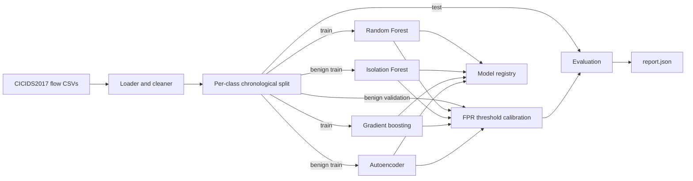
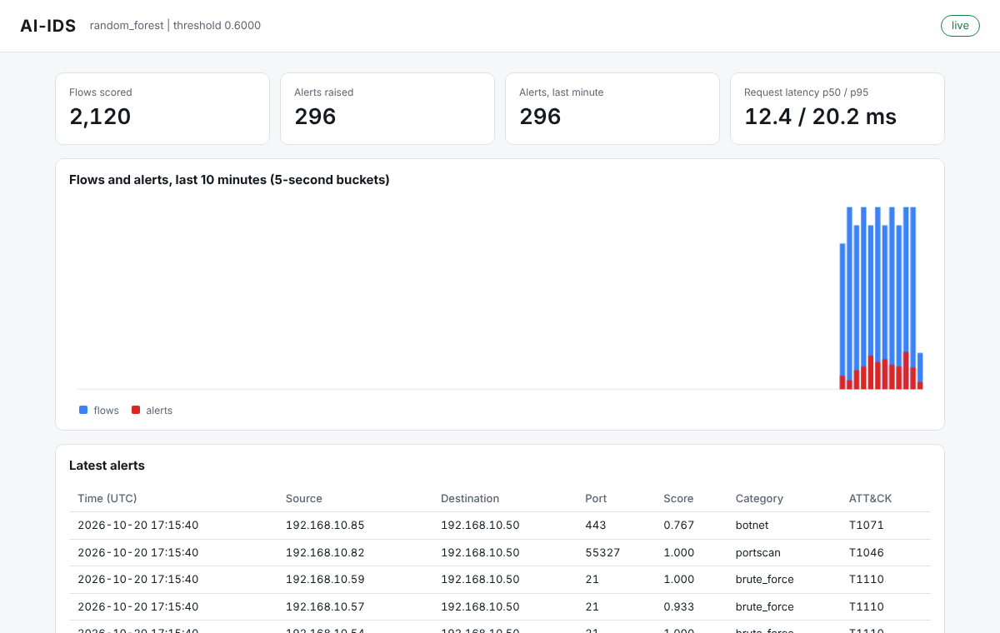

# AI-IDS

[](https://github.com/TurlaFSB/AI-IDS/actions/workflows/ci.yml)
[](LICENSE)


**A machine-learning network intrusion detector, and an honest measurement of how far such
detectors can be trusted.** AI-IDS pairs a reproducible training and evaluation pipeline with a
scoring service, and reports what benchmark IDS numbers usually hide: the false-alarm rate on later
data, performance on attack families never seen, evasion, and what happens on a second dataset.

> **Status: v0.1, research prototype.** Offline training, evaluation, a scoring service and a
> dashboard exist and are tested. There is no live capture, and nothing here is validated for
> production use. Every number below comes from a recorded run (config, seed, commit) in
> [docs/results-full.md](docs/results-full.md).

## Findings at a glance

All on public benchmark data. Detectors are trained on CICIDS2017 with a per-class chronological
split and an alert threshold calibrated for a **1% false-positive rate**.

| # | Finding | Evidence |
|---|---|---|
| 1 | In-distribution recall is high (0.99), but the 1% false-positive target **did not hold** on later data: 8.1% for the Random Forest (95% CI 4% to 12%). | 98.6% of false positives come from two scan-like hosts, which the corrected labels classify as attacks, so this is mostly label noise, not model failure. |
| 2 | **Unseen attack families are mostly missed on the original labels:** leave-one-family-out recall 0.27 (pooled) against 0.99 on known attacks. On corrected labels the pooled figure is 0.88, but the families are no longer independent (DoS/DDoS, port scan/infiltration scan), while botnet, brute force and web attacks are at 0.51, 0.58 and 0.13 (web attacks were 0.87 on the original labels, on 538 flows of which most are now dropped as attempts). | High benchmark recall largely measures recognition of the dataset's attack tools; the correction mostly makes the held-out families resemble the training ones. |
| 3 | **Feature-space evasion works.** Slowing and padding cut Random Forest recall from 0.99 to 0.52 against a per-flow adaptive adversary; web attacks fall from 0.97 to 0.02. | Evasion-aware training recovers part of it (0.99 to 0.90). A first, asymmetric defence "worked" only by learning padded means attack and is kept as a documented failure (ADR 0008). |
| 4 | **A 2017 threshold does not transfer to 2018:** recall 0.05 to 0.09 on CSE-CIC-IDS2018. | Gradient boosting still *ranks* 2018 traffic well (PR-AUC 0.90) and reaches recall 0.83 at 0.26% false positives with a threshold set on the target's benign traffic. |
| 5 | **Bot is invisible at the calibrated threshold** in every detector, yet ranks above most benign traffic. | Held-out AUC 0.86 to 0.90 on 2017; the Random Forest labels all 2018 Bot benign. On corrected labels the 490 held-out Bot flows were "attempted" flows and Bot recall is 0.99. |
| 6 | **Retrained on the corrected labels, the 1% target roughly holds** (Random Forest 1.3% false positives, recall 0.9997; Bot recall 0.99) | The comparison is easier as well as cleaner (99,638 hard "attempted" flows are dropped), and the label rules use ports that are also model features, but dropping the destination port changes recall by under 0.001. Evasion results have not been repeated. |

Read [what is not shown](docs/results-summary.md#what-is-not-shown) before quoting any of these.
Caveats that matter most: one network and attack toolset per dataset, feature-space (not
packet-level) evasion, one seed for most robustness experiments, and a partial 2018 attack mix.

## Contents

- [Quickstart](#quickstart)
- [Datasets](#datasets)
- [Command-line reference](#command-line-reference)
- [Reproducing the results](#reproducing-the-results)
- [Architecture](#architecture)
- [Live demo](#live-demo-scoring-service-and-dashboard)
- [Evaluation methodology](#evaluation-methodology)
- [Features](#features)
- [Limitations](#limitations)
- [Responsible use](#responsible-use)
- [Project layout](#project-layout)
- [Documentation](#documentation)
- [Security](#security)
- [Roadmap](#roadmap)
- [Contributing](#contributing)
- [Citation and acknowledgements](#citation-and-acknowledgements)
- [License](#license)

## Quickstart

Requires Python 3.11 or newer.

```bash
git clone https://github.com/TurlaFSB/AI-IDS.git
cd AI-IDS
python -m venv .venv
source .venv/bin/activate          # Windows: .venv\Scripts\activate
pip install -e ".[dev]"
# Fully reproducible, hash-verified install (recommended for CI and releases):
#   pip install --require-hashes -r requirements/dev.txt && pip install --no-deps -e .

# Verify the pipeline on synthetic data (no download needed)
ai-ids synth --out data/synthetic.csv --rows 30000
ai-ids train --data data/synthetic.csv --out models/demo --config configs/default.yaml
```

Results on synthetic data only show that the pipeline works. They say nothing about detection
performance on real traffic.

Run the quality gates:

```bash
ruff check src tests && ruff format --check src tests
mypy
pytest
```

### Container

```bash
docker build -t ai-ids .
docker run --rm --read-only ai-ids --version
# Mount data and config read-only, and an output directory explicitly:
docker run --rm --read-only \
  -v "$PWD/data:/data:ro" -v "$PWD/configs:/configs:ro" -v "$PWD/models:/out" \
  ai-ids train --data /data/raw/TrafficLabelling --out /out/run --config /configs/default.yaml
```

The image is multi-stage, runs as a non-root user, and pins its base image by digest.

## Datasets

Datasets are never committed (`data/` is git-ignored) and are not redistributed. Download them from
their owners, follow their terms, and cite them (see [Citation](#citation-and-acknowledgements)).
Provenance, privacy and retention rules: [docs/data-governance.md](docs/data-governance.md).

### CICIDS2017 (training and in-distribution evaluation)

1. Download the labelled flow files (`GeneratedLabelledFlows.zip` and its `.md5`) from
   <https://www.unb.ca/cic/datasets/ids-2017.html>, verify the MD5, and unzip so the CSVs are in
   `data/raw/TrafficLabelling/`.
2. Record digests for traceability: `ai-ids checksum data/raw/TrafficLabelling`
3. Train: `ai-ids train --data data/raw/TrafficLabelling --out models/cicids2017 --config configs/default.yaml`

The full dataset needs a few GB of RAM (`configs/light.yaml` is sized for laptops).

**Corrected labels (optional).** `corrected_labels: true` in the config (see
[configs/corrected.yaml](configs/corrected.yaml)) re-labels flows from the attack timelines
published by Engelen et al. (see [ADR 0013](docs/adr/0013-corrected-labels.md)). It is a port of
their label rules written from the papers, not their code or their repaired flow extractor, and it
has not yet been checked against their published corrected CSVs. Report corrected-label runs
separately from original-label runs. `ai-ids relabel` shows what changes without training.

### CSE-CIC-IDS2018 (cross-dataset transfer test only)

Used only to score models trained on 2017; nothing is trained on it. The data are hosted on a public
AWS bucket and need no account:

```bash
# list (optional)
aws s3 ls --no-sign-request s3://cse-cic-ids2018/ --human-readable
# download the processed CICFlowMeter day files used by the transfer test
mkdir -p data/raw/cse2018
for f in Thursday-15-02-2018 Thursday-22-02-2018 Friday-02-03-2018; do
  aws s3 cp --no-sign-request \
    "s3://cse-cic-ids2018/Processed Traffic Data for ML Algorithms/${f}_TrafficForML_CICFlowMeter.csv" \
    data/raw/cse2018/
done
ai-ids checksum data/raw/cse2018
```

(On Windows PowerShell use a `foreach` loop and `data\raw\cse2018`.) The loader scores every CSV in
the folder, so keep only the days you want there.

Things to know before trusting any 2018 number:

- **The processed day files are truncated.** Each has exactly 1,048,575 data rows, Excel's row
  limit, so they were almost certainly exported through a spreadsheet and the attack mix is partial.
  The loader flags this (`possibly_truncated_files` in the cleaning report). The bucket also holds
  `Original Network Traffic and Log data/` (raw captures); using those would need a flow extractor
  and is future work.
- Column names differ from 2017 and are aliased (all 78 model features match). There are no source
  or destination addresses in these files, and a handful of rows are dated 1970 (set to missing).
- `rst_flag_count` and `ece_flag_count` are identical in all but one row of the Bot day.

Run the transfer test and the attack-family comparison:

```bash
ai-ids transfer --data data/raw/cse2018 --model-dir models/robust3/hist_gradient_boosting_aug \
  --config configs/robustness.yaml --max-rows 1000000 --calibration-fraction 0.15 --out reports/transfer.json
ai-ids family --source-data data/raw/TrafficLabelling --target-data data/raw/cse2018 \
  --category Bot --out reports/family_bot.json
```

## Command-line reference

| Command | Purpose |
|---|---|
| `ai-ids synth` | Write a synthetic CICIDS2017-style CSV (pipeline checks only; says nothing about detection quality) |
| `ai-ids train` | Load, clean, split, train, calibrate, evaluate and save detectors |
| `ai-ids seeds` | Repeat training over several seeds and report the spread |
| `ai-ids analyze` | Re-run evaluation diagnostics (per-day FPR, host concentration, drift) on a saved model |
| `ai-ids holdout` | Leave-one-attack-family-out generalisation test, optionally with `--group` to hold out related families together (slow; ADR 0015) |
| `ai-ids adaptive` | Per-flow best-of-grid evasion adversary against a saved model (ADR 0012) |
| `ai-ids transfer` | Score another dataset with a saved model and a fixed threshold; compare with oracle and local calibration (ADR 0011) |
| `ai-ids family` | Descriptive comparison of one attack family across two datasets |
| `ai-ids relabel` | Apply the corrected CICIDS2017 labels and report what changed (ADR 0013) |
| `ai-ids relabel-check` | Audit the corrected-label rules against the authors' labelling script, which is read as data and never run (ADR 0013) |
| `ai-ids report-html` | Build one self-contained HTML results page from saved reports (no scripts, no network; ADR 0014) |
| `ai-ids serve` | Run the scoring service and dashboard |
| `ai-ids replay` | Replay recorded or synthetic flows into a running service |
| `ai-ids checksum` | Print SHA-256 digests of dataset files |

Experiments are configured in YAML: [configs/default.yaml](configs/default.yaml), `light.yaml`
(laptops), `robustness.yaml` (standard vs evasion-aware training, ADR 0008) and `corrected.yaml`.
Unknown keys are rejected. `configs/ablation.yaml` repeats the corrected-label run without the
destination port (`exclude_features`) as a shortcut check. To sign model artifacts, set `AI_IDS_MODEL_HMAC_KEY`
(see [.env.example](.env.example)) before training; the same key is then required to load them.
Each run writes one directory per detector (`model.joblib`, `manifest.json`) and a `report.json`
with metrics, operating points, per-attack recall, per-day FPR, drift, latency, dataset digests and
the git commit.

## Reproducing the results

The full recipe, times and what is deterministic are in [docs/reproduce.md](docs/reproduce.md). A pipeline check
that needs no download runs in about a minute: `./scripts/reproduce_synthetic.sh` (also run by CI).

```bash
ai-ids train --data data/raw/TrafficLabelling --out models/robust3 --config configs/robustness.yaml
ai-ids seeds --data data/raw/TrafficLabelling --out reports/seeds.json --config configs/robustness.yaml
ai-ids adaptive --data data/raw/TrafficLabelling --model-dir models/robust3/random_forest_aug \
  --config configs/robustness.yaml --out reports/adaptive.json
```

Seeds are fixed, each report records the dataset SHA-256 digests, the git commit and a dirty flag,
and the 2017 results were reproduced exactly on a repeat run. Full runs take hours on a 16 GB
laptop. The corrected-label retraining (`configs/corrected.yaml`) is recorded in
[docs/results-full.md](docs/results-full.md); the destination-port ablation
(`configs/ablation.yaml`) is recorded there too.

Turn saved reports into one shareable page (no server, no scripts):

```bash
ai-ids report-html --run original=models/robust3/report.json --run corrected=models/corrected/report.json \
  --adaptive random_forest_aug=reports/adaptive.json --out reports/results.html
```

## Architecture



More detail, including the scoring-service diagram, is in [docs/architecture.md](docs/architecture.md).

## Live demo: scoring service and dashboard

A trained model can be served and watched in a browser. This runs on synthetic data and shows the
plumbing, not detection quality.

```bash
ai-ids synth --out data/synthetic.csv --rows 30000
ai-ids train --data data/synthetic.csv --out models/demo --config configs/light.yaml
ai-ids serve --model-dir models/demo/random_forest --demo   # prints the dashboard URL and keys
# second terminal, with the printed score key:
AI_IDS_API_KEY=<printed key> ai-ids replay --synthetic --rate 20
```



*Synthetic data. The dashboard shows throughput, alerts, request latency percentiles and recent
alerts with their ATT&CK technique IDs.*

For real deployments see the [runbook](docs/runbook.md) and [API reference](docs/api.md): the
service has no TLS of its own, binds to loopback unless told otherwise, and keeps alerts (which
may contain IP addresses) in memory only.

## Evaluation methodology

- **Chronological, per-class splits (no flow-level random splits).** Within each attack type the earliest 60% of flows train the
  model, the next 15% calibrate the threshold, and the latest 25% test it
  ([ADR 0002](docs/adr/0002-chronological-split.md)).
- **Threshold chosen without peeking.** The alert threshold is the benign validation-score
  quantile for the target FPR (default 1%), so validation FPR is bounded by construction. Test
  FPR is measured, not assumed ([ADR 0004](docs/adr/0004-fpr-calibrated-threshold.md)).
- **Accuracy is never the headline metric.** Traffic is heavily imbalanced; recall, FPR, and
  PR-AUC are reported, with per-attack recall and support.
- **Uncertainty.** Each report carries 95% time-block bootstrap intervals for recall, false-positive
  rate and precision (whole 5-minute blocks are resampled, because flows within an attack run are
  correlated; ADR 0009), and `ai-ids seeds` measures spread across random seeds.
- **Latency** is measured per scoring call, single inference thread, after warm-up.
- Results are reported at several operating points (0.1%, 1%, 5% target FPR), per capture day,
  per capture day and hour, with a profile of where false positives concentrate, and with a
  benign-traffic drift summary (Population Stability Index per feature).

## Features

| Area | What is implemented |
|---|---|
| Data | CICIDS2017 loader: label normalisation, duplicate and non-finite value handling, timestamp repair |
| Splitting | Per-class chronological train / validation / test split (no random splits) |
| Detectors | Random Forest (supervised, multi-class), gradient boosting (supervised, continuous scores), Isolation Forest and an autoencoder (both unsupervised, benign-only training), optional evasion-aware variants and mean/max score fusion, all behind one scoring contract |
| Operating point | Alert threshold calibrated on held-out benign traffic to a target false-positive rate |
| Metrics | Recall, precision, F1, FPR, MCC, ROC-AUC, PR-AUC, per-attack recall with support, scoring latency (p50/p95/p99), time-block bootstrap confidence intervals, multi-seed spread |
| Model registry | SHA-256 manifest per artifact, optional HMAC-SHA256 signature, recorded environment versions |
| Threat mapping | Each attack type mapped to a MITRE ATT&CK technique for alert enrichment |
| Robustness | Feature-space evasion-sensitivity analysis (timing and packet-size reshaping) per detector, leave-one-attack-family-out test, per-day FPR and benign-drift (PSI) diagnostics |
| Service | Flask/waitress scoring API with bearer-key scopes, rate limiting, strict validation, security headers and CSP, Prometheus metrics, health probes, OpenAPI spec, a same-origin dashboard and a replay client (ADR 0010) |
| Supply chain | Hash-locked dependencies, SHA-pinned CI actions, digest-pinned non-root container image, `bandit`, `pip-audit`, Trivy, CycloneDX SBOM |
| Engineering | Typed (`mypy --strict`), linted, 85%+ coverage gate, CI on Python 3.11-3.13 |

## Limitations

- CICIDS2017 has documented labelling and flow-construction problems (Engelen, Rimmer and Joosen,
  "Troubleshooting an Intrusion Detection Dataset: the CICIDS2017 Case Study", IEEE SPW 2021).
  Corrected-label retraining (ADR 0013) is recorded in
  [docs/results-full.md](docs/results-full.md); the headline findings 1 to 5 use the original labels,
  the rule port was audited against the authors' script and corrected (ADR 0013), so those
  corrected-label numbers come from the earlier ruleset and are being re-run, and unseen-family and
  evasion results have not been repeated on corrected labels.
- Attacks come from a small set of tools, so models learn tool signatures; the
  leave-one-family-out test quantifies how little carries over to unseen families.
- Very small classes (Heartbleed, Infiltration, and the web attacks under corrected labels) have
  tiny test sets and unreliable recall.
- The cross-dataset test covers two models, three truncated 2018 days and one seed.
- The evasion analysis is feature-space only, not packet-level, and most robustness results are
  single-seed. Performance on other networks is unknown.
- Model artifacts are pickle-based: load only verified artifacts from storage you control.
- The service is single-process with in-memory state, shared-key authentication and no TLS of its
  own. It has been checked by the project's own tests and manual browser checks, not an independent
  assessment, and no throughput or capacity figures have been measured.

## Responsible use

This is defensive tooling: detection, alerting and measurement. It contains no attack or exploit
code, and the evasion experiments perturb extracted flow features in memory to measure detector
weakness; they do not generate traffic. Flow records and IP addresses are personal data under GDPR:
minimise them, document retention, and never commit real captures. The datasets used are public
testbed captures.

## Project layout

```text
src/ai_ids/
  labels.py        attack taxonomy and MITRE ATT&CK mapping
  data/            loader, chronological split, synthetic generator
  models/          Random Forest and Isolation Forest detectors
  evaluation/      metrics and latency profiling
  registry.py      integrity-checked model artifacts
  pipeline.py      train + evaluate + persist
  service/         scoring API, dashboard, replay client
  cli.py           ai-ids command
configs/           experiment configuration
docs/              architecture, threat model, compliance, data governance, model card, ADRs
tests/             unit and end-to-end tests
```

## Documentation

| Document | Purpose |
|---|---|
| [Talk outline](docs/talk-outline.md) | Ten-minute presentation structure with hard questions |
| [Reproducing the results](docs/reproduce.md) | Synthetic pipeline check, real-data runs, timings, determinism |
| [Results at a glance](docs/results-summary.md) | One-page summary of findings and what is not shown |
| [Full results record](docs/results-full.md) | Every run, including failed designs and negative results |
| [Architecture](docs/architecture.md) | Components, data flow, target design |
| [Threat model](docs/threat-model.md) | STRIDE analysis and mitigations |
| [Standards alignment](docs/compliance.md) | NIST CSF 2.0, NIST SP 800-53, MITRE ATT&CK, OWASP ASVS |
| [API reference](docs/api.md) | Endpoints, authentication, errors, configuration |
| [Runbook](docs/runbook.md) | Operating the scoring service |
| [Data governance](docs/data-governance.md) | Provenance, privacy (GDPR), retention |
| [Model card](docs/model-card.md) | Intended use, evaluation protocol, limitations |
| [Decision records](docs/adr/README.md) | Why the design is the way it is |
| [Changelog](CHANGELOG.md) | Release history |


## Security

- Report vulnerabilities privately; see [SECURITY.md](SECURITY.md).
- Model artifacts are verified (SHA-256, optional HMAC-SHA256) before loading, but they remain
  pickle-based: loading one executes code. Only load artifacts you trained and stored yourself.
- Datasets, captures, trained models, and secrets are git-ignored and must never be committed.
- Dependencies are hash-locked and installed with `--require-hashes`; third-party CI actions are
  pinned to commit SHAs; the container base image is pinned by digest and scanned with Trivy; CI
  also runs `bandit`, `pip-audit`, and produces a CycloneDX SBOM ([ADR 0006](docs/adr/0006-supply-chain-integrity.md)).


## Roadmap

1. Retrain on the corrected labels and compare false-positive rate, host concentration and the Bot
   test set with the original-label run; re-run the corrected-label experiments under the audited rules (ADR 0013).
2. Packet-level evasion evaluation (needs raw captures and the original flow extractor).
3. Untruncated CSE-CIC-IDS2018 flows built from the raw captures.
4. Live flow capture through the scoring service; threat-intelligence enrichment.
5. Drift detection (PSI/KS) gating retraining, with champion/challenger promotion and rollback.

## Contributing

Contributions are welcome; see [CONTRIBUTING.md](CONTRIBUTING.md) and the
[Code of Conduct](CODE_OF_CONDUCT.md).


## Citation and acknowledgements

To cite this software, use [CITATION.cff](CITATION.cff) (GitHub's "Cite this repository").

This project uses the CIC-IDS-2017 dataset from the Canadian Institute for Cybersecurity,
University of New Brunswick. If you use results derived from it, cite:

> I. Sharafaldin, A. H. Lashkari, and A. A. Ghorbani, "Toward Generating a New Intrusion Detection
> Dataset and Intrusion Traffic Characterization," *4th International Conference on Information
> Systems Security and Privacy (ICISSP)*, 2018.

## License

[MIT](LICENSE)
