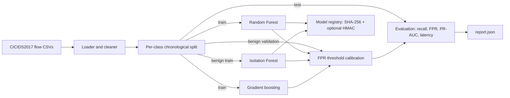
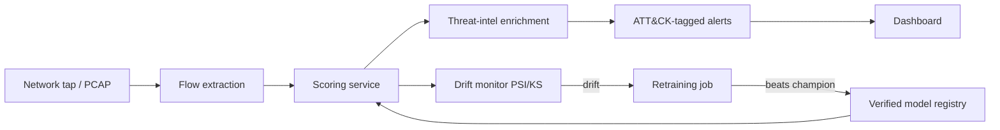

# Architecture

## Current system (v0.1)

| Stage | Module | Responsibility |
|---|---|---|
| Load and clean | `ai_ids.data.loader` | Normalise columns and labels, coerce numeric features, drop duplicates, replace non-finite values, repair 12-hour timestamps |
| Split | `ai_ids.data.split` | Per-class chronological train/validation/test split |
| Detect | `ai_ids.models.detectors` | Turn flow features into an attack score (higher = more suspicious) |
| Calibrate | `ai_ids.evaluation.metrics.threshold_for_fpr` | Choose the alert threshold from benign validation scores |
| Evaluate | `ai_ids.evaluation.metrics` | Detection metrics, per-attack recall, latency percentiles |
| Persist | `ai_ids.registry` | Versioned artifacts with integrity manifest |
| Orchestrate | `ai_ids.pipeline`, `ai_ids.cli` | End-to-end training run and command-line entry points |

## Design principles

1. **Honest evaluation first.** Leakage-free splits and calibrated false-positive rates come
   before model sophistication (see ADR 0002 and 0004).
2. **Detectors share one contract.** Every detector returns a score where higher means more
   suspicious, so threshold calibration, metrics, and later serving code are model-agnostic.
3. **Models are untrusted until verified.** Artifacts are checked before they are loaded
   (ADR 0003).
4. **Explicit over implicit.** Unknown labels fail loudly; configuration rejects unknown keys.

## Target architecture (roadmap)

Components not yet implemented: live flow extraction, scoring service, threat-intelligence
enrichment, drift monitoring, retraining with champion/challenger promotion, dashboard.
